# Mail Template Hub

Connect Gmail and Outlook via OAuth, design responsive email templates — visually, in MJML or raw
HTML, hand-edited or generated/revised from a prompt by Claude — manage a shared asset library, and
send or schedule tracked email straight from the providers' own APIs.

**Spec-driven:** the full technical specification lives in [docs/spec/](docs/spec/README.md).
The build follows [docs/spec/12-implementation-plan.md](docs/spec/12-implementation-plan.md).

## Screenshots

Two themes, one app: **Mailroom** (light — lilac paper, ink borders, hard offset shadows, Space Grotesk)
and **Nocturne** (dark — near-black surfaces, hairline borders, a violet accent, Geist). Toggle with the
sun/moon button; the choice is remembered. Screenshots use demo data.

|                                                                     |                                                                     |
| :-----------------------------------------------------------------: | :-----------------------------------------------------------------: |
| 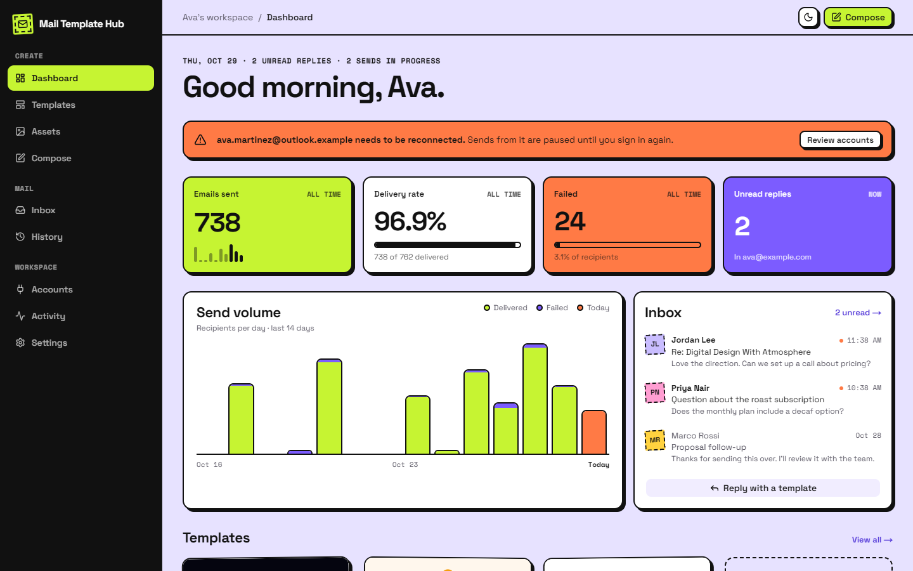          | 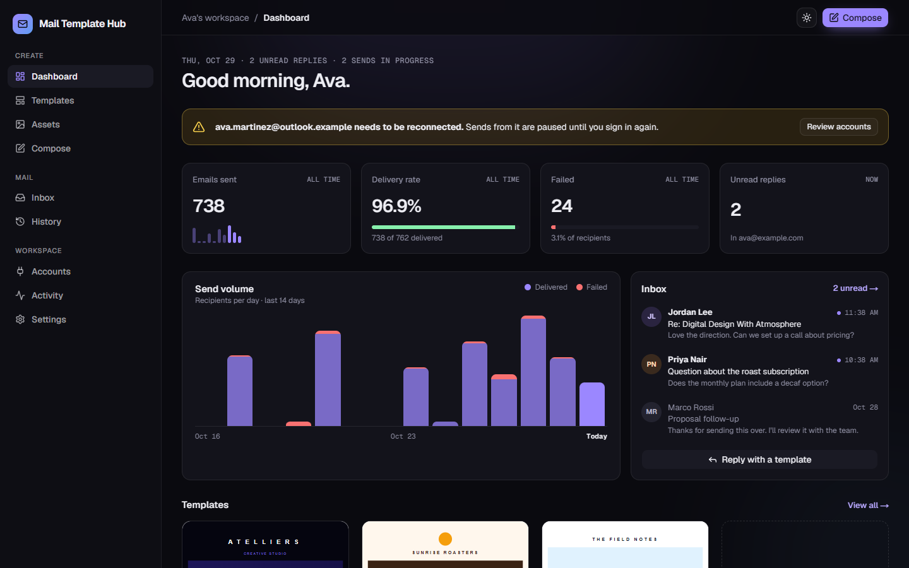            |
| Dashboard — setup progress, 30-day KPIs, send volume, replies waiting | The same dashboard in Nocturne                                     |
| 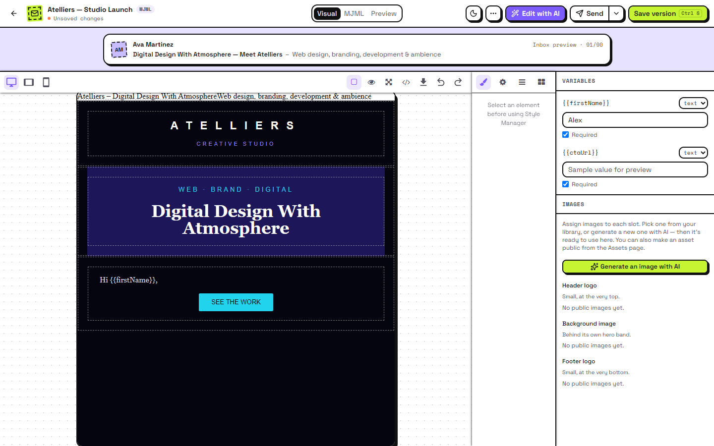 | 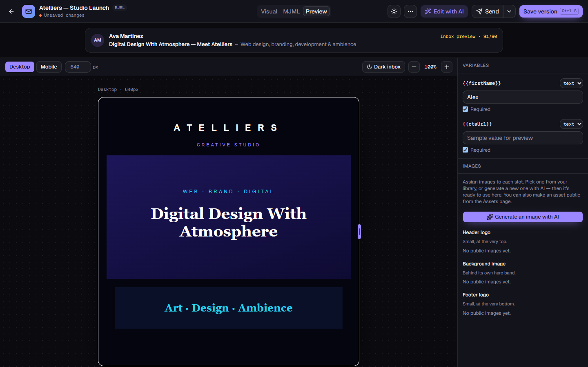 |
| Full-screen editor: visual builder, inbox-style subject/preheader bar, variables & images rail | Preview on a dotted canvas — Desktop/Mobile, exact width, zoom, and a simulated dark inbox |
| 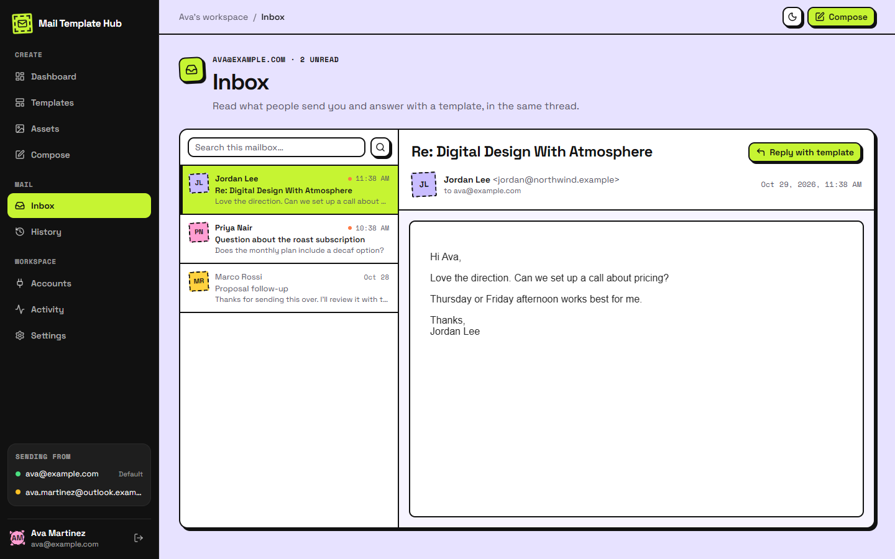                         | 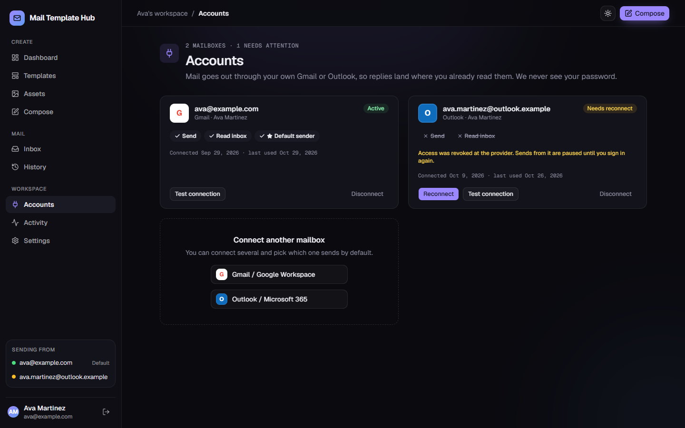                    |
| Read your inbox and answer in-thread with a template               | Connected Gmail/Outlook mailboxes, capabilities and reconnect state |
| 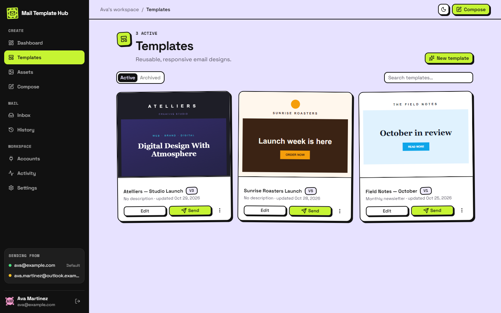                 | 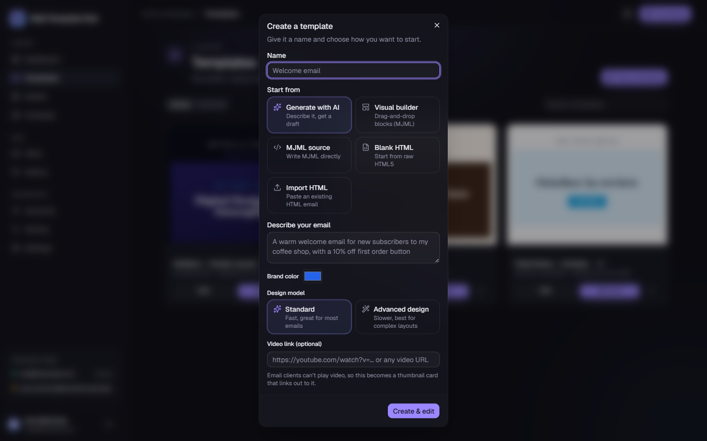 |
| Templates with live thumbnails, versioning, duplicate, archive      | Generate a template from a prompt, choosing a Standard or Advanced design model |
| 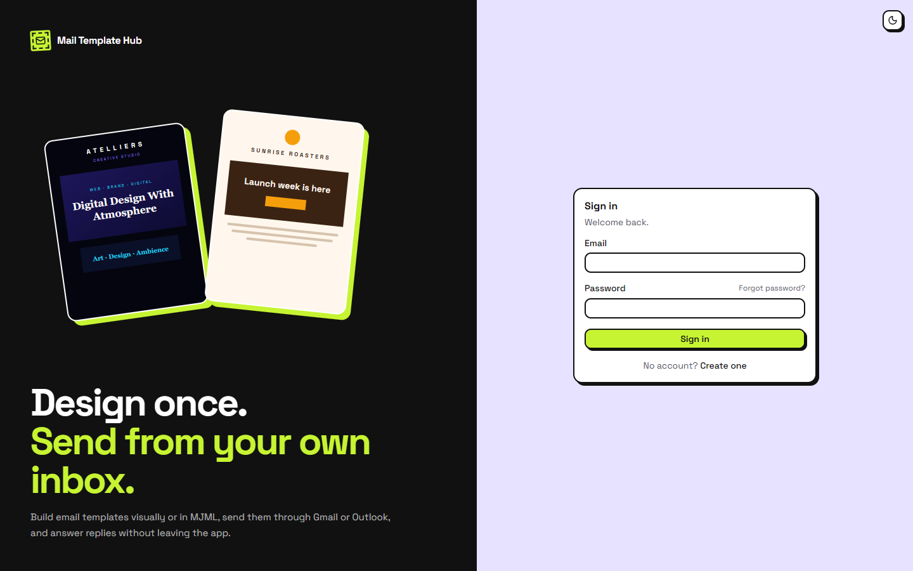                       | 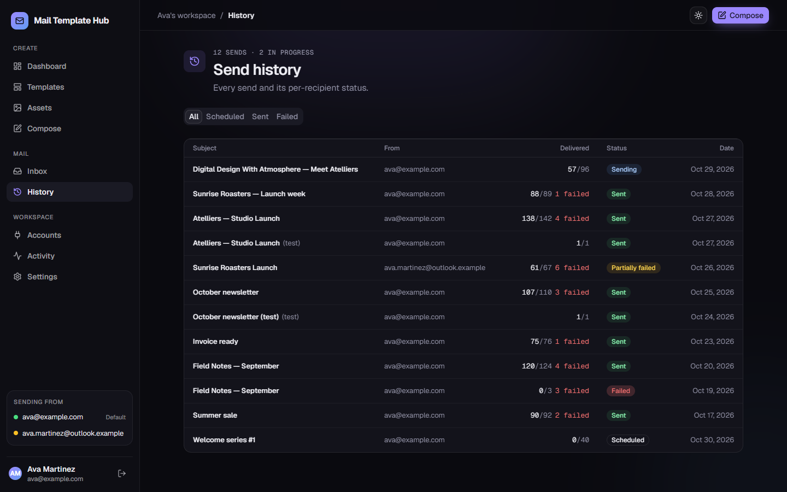                 |
| Sign in                                                             | Every send with per-recipient delivery and status                   |
| 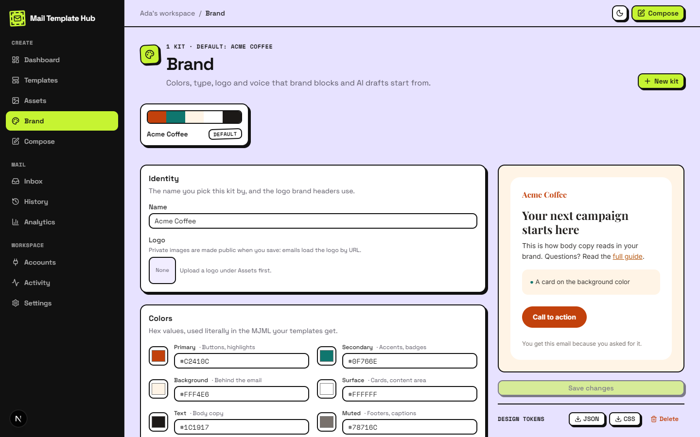                     | 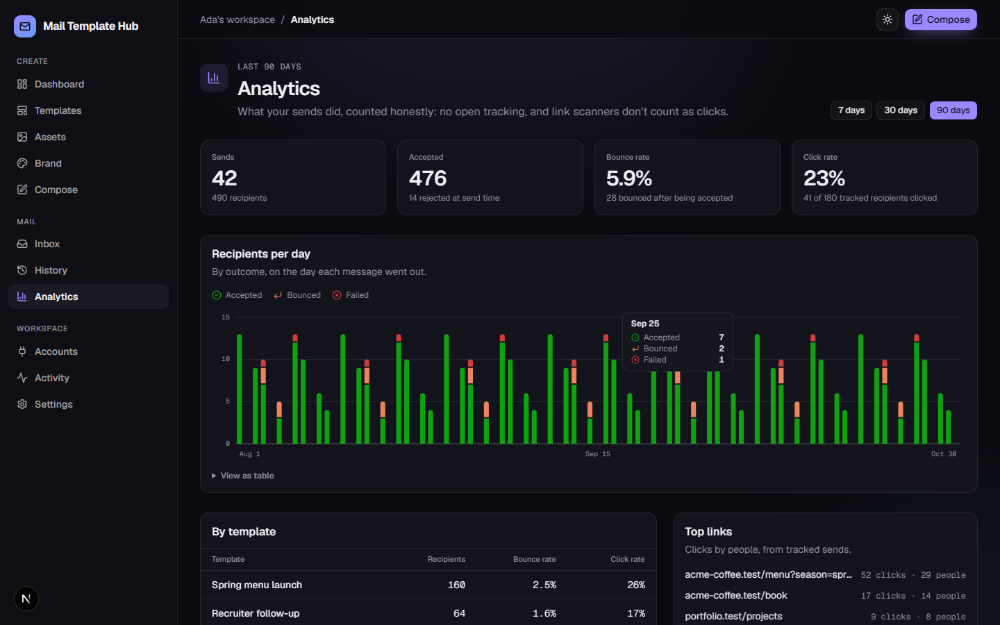                  |
| Brand kit: colors, fonts, logo, buttons and voice, with a live sample and design-token export | Analytics: accepted, bounce rate, click rate by people (not scanners), per day and per template (sample data) |

## Features

- **Own-inbox sending** — OAuth-connect Gmail and/or Outlook (we never see your password) and send
  through the provider's own API, so mail comes from your real address.
- **Read your inbox and reply with a template** — answer a real conversation instead of starting a
  new one: the reply keeps the thread's subject, goes back to whoever wrote, and lands in the same
  conversation in the recipient's client. Inbox read access is a **separate, optional consent** —
  decline it and everything else keeps working.
- **Three ways to build a template** — a drag-and-drop visual builder (GrapesJS) on top of MJML,
  raw MJML/HTML source with a live sandboxed preview, or **generate one from a natural-language
  prompt** with Claude, picking a **Standard** (fast) or **Advanced design** (higher-effort,
  Claude Opus) model per generation. AI generation streams the response and automatically
  continues across dropped connections or token-limit cutoffs, so long, detailed designs still
  come back complete.
- **Edit any template with AI** — for MJML, visual, or raw-HTML templates alike, describe a change
  ("make the CTA orange, add a coupon section") and the model revises the existing template in
  place instead of starting over.
- **Manual image placeholders** — assign a background image, header logo, and footer logo directly
  from your asset library, no AI involved; the corresponding MJML block is inserted/updated/removed
  for you.
- **Convert a template's format** — switch an existing template between MJML (visual builder +
  source view) and raw HTML at any time; MJML compiles down to static HTML, and HTML wraps
  losslessly into MJML (`mj-raw`) to go the other way.
- **Focused editor** — the template editor takes the full screen with its own header: one primary
  **Save version** (⌘S / Ctrl+S), a Send menu (test to yourself or send to recipients), and the rest
  tucked under "⋯". Subject and preheader are edited in an inbox-style row that shows how they'll
  read in a recipient's list, with a length hint.
- **Live preview on a work canvas** — Desktop/Mobile presets, an exact-pixel width field, a drag
  handle, zoom, and a simulated dark-mode inbox to sanity-check how clients recolor the email.
- **Asset library** — presigned direct-to-storage uploads (MinIO/S3) with image/GIF/document
  support, dedupe, and per-user quota.
- **Scheduled & tracked sending** — queue, schedule, or test-send to yourself; per-recipient
  status with retries, backed by Hangfire.
- **Brand kits** — palette, heading/body fonts, logo, button style, radius/spacing tokens and a
  tone of voice. The visual builder gets "Brand" blocks (header, hero, card, button, footer)
  with the kit's values written in, AI generation follows the kit exactly, and every kit exports
  as design tokens (JSON or CSS custom properties).
- **AI copy variations** — rewrite a subject, preheader, text block or button label in a
  promotional, professional, technical or follow-up tone, in your brand's voice. Suggestions
  that drop or invent a `{{variable}}` are thrown away server-side, and the model is told never
  to add facts you didn't write.
- **Honest analytics** — opt-in click tracking per send (links go through a short redirect;
  unsubscribe links never do), UTM tagging for conversions in your own site analytics, and
  bounces read from delivery reports in your mailbox. Clicks from link scanners (Safe Links,
  Proofpoint, Mimecast…) are labeled and left out; there is no open rate, because Apple Mail and
  Gmail's image proxy make it noise. See [docs/spec/14-outreach-studio.md](docs/spec/14-outreach-studio.md).
- **Activity log** — an auditable record of security-relevant events per account.
- **Automation-friendly** — a scoped API-key auth scheme for scripting sends (see
  [docs/integrations/n8n-whatsapp.md](docs/integrations/n8n-whatsapp.md) for the n8n/WhatsApp
  approve-and-send workflow).
- **Two designed themes** — Mailroom (light) and Nocturne (dark), each with its own type, borders and
  shadows rather than an inverted palette.

## Stack

ASP.NET Core (.NET 10) · EF Core + PostgreSQL · Hangfire · MimeKit · Mjml.Net ·
MinIO/S3 · Anthropic Claude (AI template generation and copy rewrites) · Next.js App Router (TypeScript) ·
Tailwind + shadcn/ui · TanStack Query · GrapesJS · CodeMirror

## Quickstart (local dev)

Prereqs: .NET 10 SDK, Node 20+, Docker.

```bash
# 1. Infrastructure: PostgreSQL 16, MinIO (S3), WireMock provider doubles
docker compose up -d

# 2. Backend API → http://localhost:5001  (health: /healthz)
dotnet run --project MailTemplateHub.Api

# 3. Frontend → http://localhost:3000 (proxies /api/* to the backend)
cd frontend && npm install && npm run dev
```

MinIO console: http://localhost:9001 (minioadmin / minioadmin).
Buckets `mth-private`, `mth-public` (anonymous download), `mth-snapshots` are created automatically.

AI template generation needs an Anthropic API key: set `Ai:ApiKey` (or `Ai__ApiKey`) via user
secrets/environment. Without a key, template generation falls back to a deterministic scaffold
so the rest of the app still works. `Ai:Model` / `Ai:AdvancedModel` control which model each
design tier uses (defaults: `claude-sonnet-5` / `claude-opus-4-8`).

The AI copy assistant uses the same key; without one it is hidden.

Click tracking needs a public address recipients can reach: set `Tracking:PublicBaseUrl`
(e.g. `https://mail.example.com`) once deployed. Until then the "Track clicks" option is shown
disabled with the reason; UTM tagging works either way. Bounce detection runs every 15 minutes
for accounts that granted inbox read access.

Real Gmail/Outlook sending needs OAuth apps registered with each provider (`OAuth:Google:*` /
`OAuth:Microsoft:*`, via user secrets) with `Mail.Send`-equivalent scopes; without them, everything
else in the app still works, but **Connect account** has nothing to connect to.

## Tests

```bash
dotnet test                        # unit + architecture + integration (integration needs Docker)
cd frontend && npm test            # vitest
```

## Solution layout

| Project | Role |
|---|---|
| `MailTemplateHub.Domain` | Entities, enums, domain errors — no dependencies |
| `MailTemplateHub.Application` | Use cases, DTOs, validators, ports (interfaces) |
| `MailTemplateHub.Infrastructure` | EF Core, provider clients, storage, crypto, jobs |
| `MailTemplateHub.Api` | Controllers, middleware, auth, composition root |
| `frontend/` | Next.js app |
| `tests/` | Unit, integration (Testcontainers), architecture tests |
